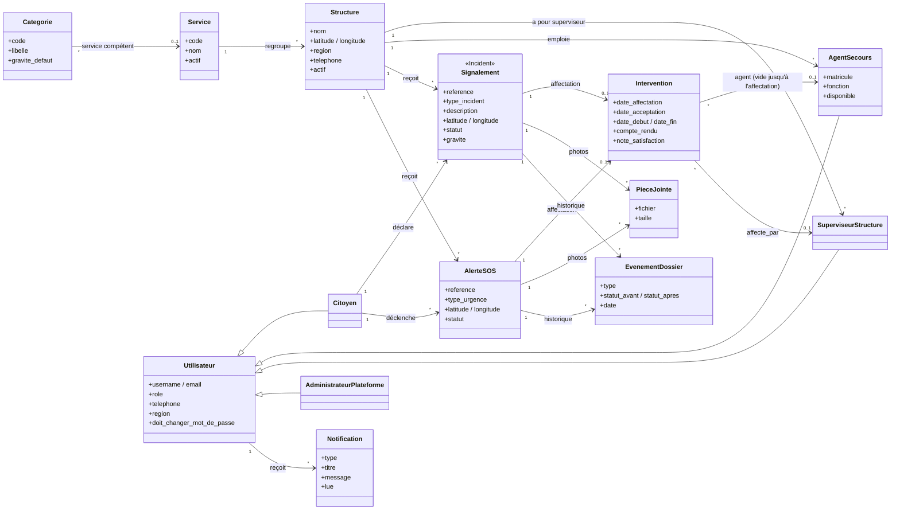

# Diagramme de classes SenAlert

Ce diagramme correspond au code (`backend/*/models.py`). Il suit la modélisation demandée par l'encadreur le 07/11/2026 :

* la **Structure** est la table centrale ;
* il n'y a qu'**une seule table Utilisateur**, dont héritent le citoyen, l'agent, le superviseur de structure et l'administrateur de la plateforme (champ `role`) ;
* les liens sont de vraies **clés étrangères**, jamais des chaînes de caractères.

## Correspondance avec le code

| Classe du diagramme | Code |
|---|---|
| Utilisateur et ses quatre sous-classes | `accounts.User`, champ `role` (`citoyen`, `agent`, `superviseur`, `superadmin`), clé étrangère `structure` vers `core.Structure` (pour les agents et les superviseurs) |
| AgentSecours (attributs propres) | `accounts.AgentProfil` (un pour un avec `User`) : `service`, `matricule`, `fonction`, `disponible` |
| Structure / Service | `core.Structure` (clé étrangère `service`) / `core.Service` |
| Signalement / AlerteSOS | `incidents.Incident` / `alerts.AlerteSOS` : clés étrangères `citoyen` et `structure` (héritées de `core.dossier.Dossier`) |
| Intervention | `incidents.Intervention` : clé étrangère `agent` **nulle à la création**, renseignée par le superviseur au moment de l'affectation |
| PieceJointe | `incidents.PieceJointe` : photo d'un incident **ou** d'un SOS |
| Notification | `notifications.Notification` : clé étrangère `destinataire` vers `User` |

## Le flux, de bout en bout

1. **L'administrateur de la plateforme** crée la structure partenaire (mairie, caserne, SAMU, brigade…), puis son superviseur, rattaché à cette structure par la clé étrangère `structure`. La liste des structures du formulaire est lue en base : une structure créée apparaît aussitôt.
2. **Le superviseur** se connecte, change son mot de passe temporaire et crée ses agents, automatiquement rattachés à sa structure.
3. **Le citoyen** signale un incident en choisissant la structure concernée : celles qui sont compétentes pour la catégorie sont proposées, la plus proche est présélectionnée. Le signalement est créé avec `structure` renseignée, sans agent, au statut « Nouveau ».
4. Le signalement n'est visible que du **superviseur de cette structure**, qui est notifié.
5. **L'affectation** : le superviseur ne peut choisir qu'un agent de sa structure. L'intervention reçoit alors l'identifiant de l'agent et le statut passe à « Affecté ».
6. **L'agent** reçoit une notification et une alerte en direct. Il ne voit que les dossiers qui lui sont affectés.
7. À chaque changement de statut (pris en charge, en cours, résolu), **le citoyen** est notifié. Il donne son avis une fois le dossier résolu.
